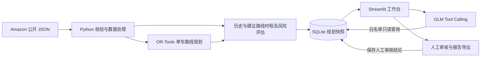

# 末端配送规划工作台 · Last-Mile AI

面向配送规划员、站点运营分析师和调度人员的本地决策支持原型。它用 Amazon 公开挑战赛的历史配送记录，对比单车历史路线与建议路线，帮助运营人员判断行驶时间的节省是否被等待或时间窗口风险抵消。系统运行在本机，与 Amazon 生产环境隔离。


上图来自已保存的真实路线模拟。建议路线预计少行驶 1,123.0 秒，但多等待 1,347.7 秒，总作业增加 224.7 秒。图中只保留对比指标与告警。数据来源和署名见下文。

## 核心功能

- **配送任务加载**。按 Amazon Route ID 读取路线、站点、历史顺序、包裹和有向行驶时间。交通矩阵按任务流式提取。
- **路线规划与对比**。OR-Tools 在 20 秒搜索预算内给出单车闭环建议。界面并排展示行驶、服务、等待和总作业时间，并突出总作业时间或窗口风险增加。
- **审查与留痕**。规划快照存入 SQLite，按路线及运行 ID 查阅。运营人员可批准或驳回，并导出 JSON 规划报告和 CSV 站点顺序。
- **AI 运营助手**。可选接入智谱 GLM，用自然语言查询已保存的指标、差值和审核状态。界面始终标注配送指标为离线模拟估计。

## 技术栈与架构

Python 3.13、ijson、OR-Tools、SQLite、Streamlit、Altair，以及通过 OpenAI Python SDK 兼容接口调用的智谱 GLM。算法、时程评估和审核分层处理。



| 位置 | 内容 |
| --- | --- |
| `app.py`、`.streamlit/config.toml` | Web 入口和主题配置 |
| `src/` | 数据读取、规划、模拟、持久化、审核、导出和 AI 工具 |
| `tests/` | `unittest` 单元测试及 Streamlit AppTest |
| `evals/` | 冻结路线样本清单、路线与 AI 评估程序、公开评估摘要 |
| `docs/` | 演示步骤及真实截图 |
| `requirements.txt`、`.env.example` | 直接依赖版本及可选 AI 配置模板 |
| `m0_check.py`、`m0_package_check.py` | 早期数据核验脚本，日常运行使用 `app.py` |
| `data/raw/`、`outputs/` | 本地原始数据、SQLite、报告及评估轨迹，由用户准备或运行生成 |

## Windows 安装与运行

在项目根目录打开 PowerShell。已验证环境为 64 位 Windows、Python 3.13.6。安装 Python 3.13 x64 后，可直接使用虚拟环境解释器。

```powershell
py -3.13 -m venv .venv
.\.venv\Scripts\python.exe -m pip install -r requirements.txt
.\.venv\Scripts\python.exe -m pip check
```

如果 `py -3.13` 找不到已安装的解释器，可用 Python 3.13 的 `python.exe` 完整路径执行 `-m venv .venv`。

### 准备数据

项目使用 [AWS 开放数据登记页](https://registry.opendata.aws/amazon-last-mile-challenges/)发布的 **2021 Amazon Last Mile Routing Research Challenge Dataset** 训练集。训练集有 6,112 条 2018 年的历史路线，数据发布方对标识与地理信息做了匿名化处理。仓库仅提供代码、复现清单与展示材料。运行配送任务前，请用 [AWS CLI](https://docs.aws.amazon.com/cli/latest/userguide/getting-started-install.html) 下载四个输入文件，约需 2.3 GB 磁盘空间。公开存储桶支持匿名访问。

```powershell
$datasetPrefix = 's3://amazon-last-mile-challenges/almrrc2021/almrrc2021-data-training/model_build_inputs/'
New-Item -ItemType Directory -Force data/raw | Out-Null
aws s3 sync $datasetPrefix data/raw/ --no-sign-request --region us-west-2 --exclude '*' --include 'route_data.json' --include 'actual_sequences.json' --include 'package_data.json' --include 'travel_times.json'
```

`data/raw/` 下应直接包含 `route_data.json`（路线和站点）、`actual_sequences.json`（历史顺序）、`package_data.json`（包裹及服务约束）、`travel_times.json`（有向行驶时间）。如果已从官方来源取得这些文件，放到该目录即可。

**数据署名。** Copyright Amazon.com, Inc. or its affiliates. 许可范围和非商业性使用要求见下文的「许可证」。[数据发布方许可证文件](https://amazon-last-mile-challenges.s3.us-west-2.amazonaws.com/almrrc2021/License.txt)

引用：Merchán, D., Arora, J., Pachon, J., Konduri, K., Winkenbach, M., Parks, S., & Noszek, J. (2022). [2021 Amazon Last Mile Routing Research Challenge: Data Set](https://www.amazon.science/publications/2021-amazon-last-mile-routing-research-challenge-data-set). *Transportation Science*. [数据登记页](https://registry.opendata.aws/amazon-last-mile-challenges/)核查于 2026-11-10。

### 可选配置 AI

首次配置时，将 `.env.example` 复制为项目根目录的 `.env`，在本地填入自己的智谱密钥。已有 `.env` 时直接编辑现有文件。密钥通过进程环境变量或本地 `.env` 读取，进程环境变量优先。规划、审核、导出和自动化测试可以在缺少密钥时运行。

| 变量 | 用途 |
| --- | --- |
| `ZHIPU_API_KEY` | 智谱 API 密钥，模板留空 |
| `ZHIPU_MODEL` | 默认示例 `glm-4-flash-250414`，即历史真实评估使用的模型 |
| `ZHIPU_BASE_URL` | 兼容接口根地址，模板为 `https://open.bigmodel.cn/api/paas/v4` |

### 启动工作台

```powershell
.\.venv\Scripts\python.exe -m streamlit run app.py --server.address 127.0.0.1
```

打开 `http://127.0.0.1:8501`。在「当前规划」保留默认路线 `RouteID_00143bdd-0a6b-49ec-bb35-36593d303e77`，点击「加载配送任务」和「生成建议路线」。首次读取可能需要等待。生成的快照会保存到 `outputs/planning_runs.sqlite3`，随后可在「历史规划记录」中审核或导出。完整演示步骤见 [演示说明](docs/demo.md)。

## AI Tool Calling 流程

1. 在历史规划记录中选择一个运行，或在问题中给出明确的 `run_id`。查询路线列表时使用 Amazon Route ID。
2. GLM 按问题选择 `list_planning_runs`、`get_planning_run` 或 `compare_planning_run`。应用校验工具名与参数，在本机只读查询 SQLite，再把工具结果反馈给模型。
3. 应用按当前运行和指标校验证据。识别到具体时长缺少本轮证据时，可在额度内补查，再展示有依据的值；仍无法核实时说明原因。工具查询和证据补查有独立标记，批准或驳回由用户在工作台完成。

启用 AI 后，问题、对话上下文及工具返回的必要规划快照字段会发往配置的智谱接口。每轮最多 4 次工具调用、5 次请求，单次超时 20 秒，SDK 自动重试关闭。

## 历史评估结果

### 路线规划 · M6-4

固定的 12 条 Amazon 历史路线中，**12/12 求解成功，12/12 预计行驶时间减少，10/12 预计总作业时间减少**。逐路线改善率的算术平均分别为 **10.89%** 和 **2.77%**。**3 条路线出现新增模拟时间窗口风险，共 5 个包裹**。这是 12 条探索性样本的离线模拟结果。实际运营绩效与全局最优性超出这组评估的证明范围。

### AI 助手 · M6-3B 与 M6-5A

- 原始 12 题真实模型评估中，**6/12** 通过人工复核。
- 工程修复后的独立验收覆盖 **3 个场景、4 轮对话**。模型原答 **3/4** 轮数值正确，应用证据补查后最终展示 **4/4** 轮数值正确，**2/4** 轮最终回答正文明确标注离线模拟。

两组用例、分母和通过标准各自独立，数字仅描述对应评估。详见 [公开评估报告](evals/results.md)。

## 测试与复现

```powershell
.\.venv\Scripts\python.exe -B -m unittest discover -s tests
```

测试使用内置样本、临时 SQLite 和模拟模型响应，无需下载 Amazon 数据或配置 API。真实数据到界面的单路线复现按上文运行。若要单独重现冻结的 12 条路线实验，准备四个输入文件后使用新输出目录运行下列命令。评估按清单顺序执行，每条路线的搜索预算为 20 秒。同一版本下，按时间停止的求解也可能因机器与运行负载不同而产出不同的建议路线。

```powershell
.\.venv\Scripts\python.exe -B -m evals.evaluate_routes run --start 1 --limit 12 --output-dir outputs/reproduction/routes
.\.venv\Scripts\python.exe -B -m evals.summarize_routes outputs/reproduction/routes/results.json --output-dir outputs/reproduction/summary
```

批次中断后，使用相同的参数和输出目录并附加 `--resume`。选样依据在 [冻结清单](evals/route_sample_manifest.json)。历史 AI 用例 `evals/ai_cases.json` 绑定原验收 SQLite 中的固定运行 ID 和审核状态，用例、数据库与调用轨迹均保留在本地。公开版本可用单测复现 AI 证据校验与只读边界。持有本地验收材料的维护者可依照 [评估程序说明](evals/README.md)执行离线重评。

## 项目局限

- 当前模型针对单车、同一配送站闭环，每个投递点访问一次。目标为最小化预计行驶时间，搜索有时间上限，服务及时间窗口在求解后另行评估。
- 时程模拟使用历史输入中的行驶时间、计划服务与时间窗口。站点图以直线示意访问顺序。天气、实时交通和实际签收情况超出模型范围。
- 12 条样本的结果只描述本次样本。零有效时间窗分层缺少候选，选样按冻结规则从相邻分层补足。
- AI 仍可能漏查、误读指标或省略估计口径。证据校验覆盖已识别的时长指标，人工负责最终决策。工作台定位为本地单操作员演示。

## 许可证

- **项目代码。** 原创项目代码及随附的软件文档采用 MIT 许可证，版权归 `studing-endless`（2026 年）。第三方依赖适用各自的许可证。[MIT 许可文件](LICENSE)
- **Amazon 数据与派生展示。** Amazon 挑战赛数据由 AWS 开放数据登记页发布，按 CC BY-NC 4.0 提供，使用和分享须遵守署名、非商业性使用等条款。路线样本清单、离线模拟指标和截图包含来自该数据的派生内容，MIT 授权不覆盖这些内容。公开候选文件只包含复现所需的公开路线标识、选样元数据与展示材料。原始数据从官方来源单独获取。[AWS 数据登记页](https://registry.opendata.aws/amazon-last-mile-challenges/) · [CC BY-NC 4.0](https://creativecommons.org/licenses/by-nc/4.0/)
